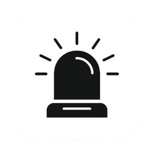
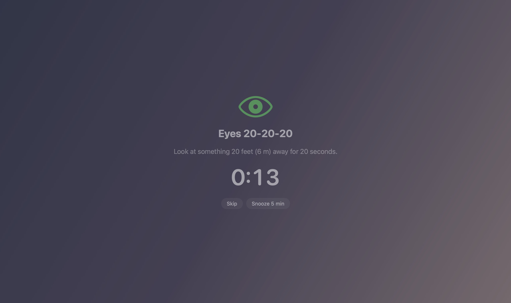
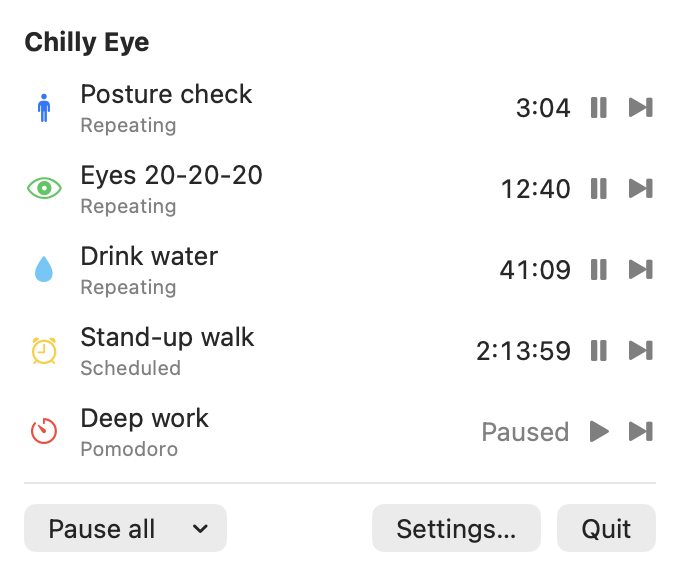
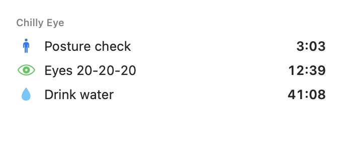
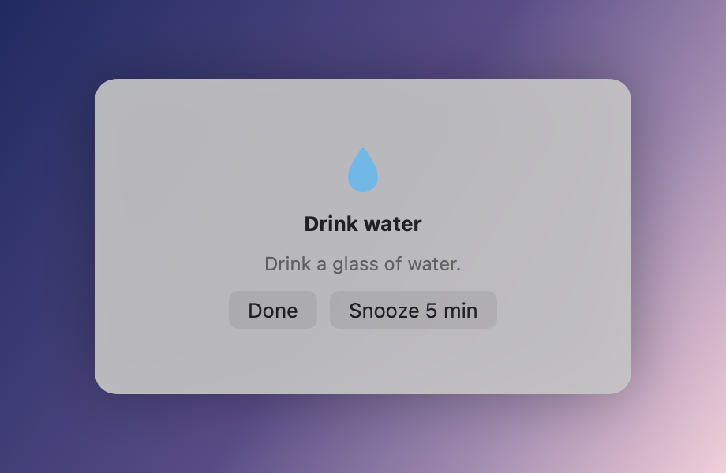
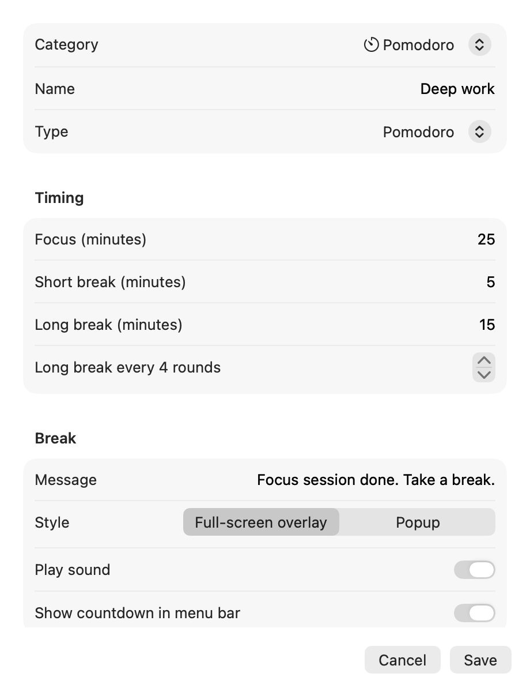

<p align="center">
  
</p>

<h1 align="center">Chilly Eye</h1>

<p align="center">
  <b>Rest your eyes, fix your posture, drink your water.</b><br>
  A macOS menu bar app for break reminders, built around the 20-20-20 rule.
</p>

<p align="center">
  <a href="https://github.com/ieCecchetti/20-eyes/releases/latest"></a>
  
  
  
  
</p>

<p align="center">
  
</p>

> **The 20-20-20 rule:** every 20 minutes, look at something 20 feet (6 m) away for 20 seconds.
> Chilly Eye reminds you, and you can add as many other timers as you like: posture, water, stretch, pomodoro, countdowns, or breaks at fixed clock times.

## Screenshots

<table>
  <tr>
    <td align="center"><br><sub>Every timer in the menu bar, soonest first</sub></td>
    <td align="center"><br><sub>The next 3 timers as a desktop widget</sub></td>
  </tr>
  <tr>
    <td align="center"><br><sub>A small popup instead of the full-screen overlay</sub></td>
    <td align="center"><br><sub>Pick a category and it fills in the defaults</sub></td>
  </tr>
</table>

## Features

- **Menu bar countdown** for the soonest timer you've pinned ("Show countdown in menu bar" on each timer). Click it to see every timer, sorted by which rings next, with pause / take break now on each.
- **Many timers, grouped by category.** New timer → pick a category (Eyes, Posture, Water, Stretch, Pomodoro, Countdown, Scheduled, Custom, or your own) → it pre-fills sensible defaults → tweak.
- **Timer types:** repeating, pomodoro (long break every N rounds), one-shot countdown, scheduled at clock times.
- **Break style per timer:** full-screen blurred overlay on every display, or a small popup. Skip, snooze, or the break ends by itself when its countdown finishes.
- **Active hours per timer**, for example Mon–Fri 9:00–18:00.
- **Smart pausing:**
  - when you're idle, the screen is locked or the Mac sleeps, timers are held, and repeating timers restart when you return (you already rested)
  - breaks are postponed during calls (camera or mic in use) and while a fullscreen app is in front
- **Pause all** for 30 min, 1 h, until tomorrow, or until resumed. Global shortcut **⌃⌥⌘P**.
- **Stats:** breaks taken / skipped / snoozed per day, and a day streak.
- **Widget** (medium): the next 3 timers with live countdowns.
- **Launch at login.**

## Requirements

- A Mac with Apple Silicon (M1 or later). Intel Macs are not supported.
- macOS 14 Sonoma or later.

## Download

1. Get the latest `ChillyEye-x.y.z.dmg` from [Releases](https://github.com/ieCecchetti/20-eyes/releases/latest).
2. Open it and drag **Chilly Eye** into **Applications**.
3. Launch it. The first time, macOS says it *could not verify* the app, because it isn't notarized by Apple yet. Click **Done**, then go to **System Settings → Privacy & Security** and click **Open Anyway**. You only need to do this once.
4. An eye icon with a countdown appears in the menu bar. Turn on *Launch at login* in Settings → General.

The downloadable build doesn't include the widget, because the widget needs a signed build. To get it, build from source (below).

To publish a new version, push a tag: `git tag v1.0.0 && git push origin v1.0.0`. GitHub Actions builds the DMG and attaches it to a Release.

## Build from source

### Build tools

- [Xcode](https://apps.apple.com/app/xcode/id497799835) 16 or later. Open it once to accept the license, then point the command line tools at it:
  ```bash
  sudo xcode-select -s /Applications/Xcode.app
  ```
- [XcodeGen](https://github.com/yonaskolb/XcodeGen): `brew install xcodegen`

### Get the code

```bash
git clone https://github.com/ieCecchetti/20-eyes.git
cd 20-eyes
```

### Install

1. **Set up signing**, which the widget needs:
   1. In Xcode → Settings → Accounts, add your Apple ID. A free Personal Team is enough.
   2. Copy your team ID (shown under the account, or in the Apple Developer portal) into `Config/Local.xcconfig`. That file is git-ignored.
      ```bash
      echo "DEVELOPMENT_TEAM = ABCDE12345" > Config/Local.xcconfig
      ```
2. **Build a release copy and install it:**
   ```bash
   xcodegen generate
   xcodebuild -project ChillyEye.xcodeproj -scheme ChillyEye -configuration Release \
     -derivedDataPath build -allowProvisioningUpdates build
   cp -R "build/Build/Products/Release/Chilly Eye.app" /Applications/
   open "/Applications/Chilly Eye.app"
   ```
   An eye icon with a countdown appears in the menu bar.
3. **Optional extras:**
   - Turn on *Launch at login* in Settings → General.
   - Add the widget: right-click the desktop → Edit Widgets → search "Chilly Eye".

The widget needs a signed build. The app and the widget share their data through an App Group (`<team>.com.cecchetti.chillyeye`), and an unsigned build has no App Group, so the widget stays empty.

**Quick try without signing (no widget):**

```bash
xcodegen generate
xcodebuild -project ChillyEye.xcodeproj -scheme ChillyEye -derivedDataPath build CODE_SIGNING_ALLOWED=NO build
open "build/Build/Products/Debug/Chilly Eye.app"
```

**Uninstall:** quit Chilly Eye from its menu, delete `/Applications/Chilly Eye.app`, then remove its data at `~/Library/Group Containers/<team>.com.cecchetti.chillyeye`.

## Develop

Run `xcodegen generate && open ChillyEye.xcodeproj`, then press ⌘R on the "ChillyEye" scheme. Run `xcodegen generate` again after you add or remove files, because the `.xcodeproj` is generated from `project.yml`.

## Tests

The scheduling, stats and storage logic lives in the `Core` Swift package:

```bash
cd Core && swift test
```

## Layout

| Path | What |
|------|------|
| `Core/` | `ChillyCore` package: models, scheduling, stats, JSON store (shared by app and widget) |
| `App/` | Menu bar app: timer engine, break overlay/popup, settings, idle/call detection, hotkey |
| `Widget/` | WidgetKit extension |
| `project.yml` | XcodeGen spec (the `.xcodeproj` is generated, not committed) |
| `scripts/` | `make-dmg.sh` (release DMG) and `render-screenshots.sh` (regenerates `docs/images`) |
